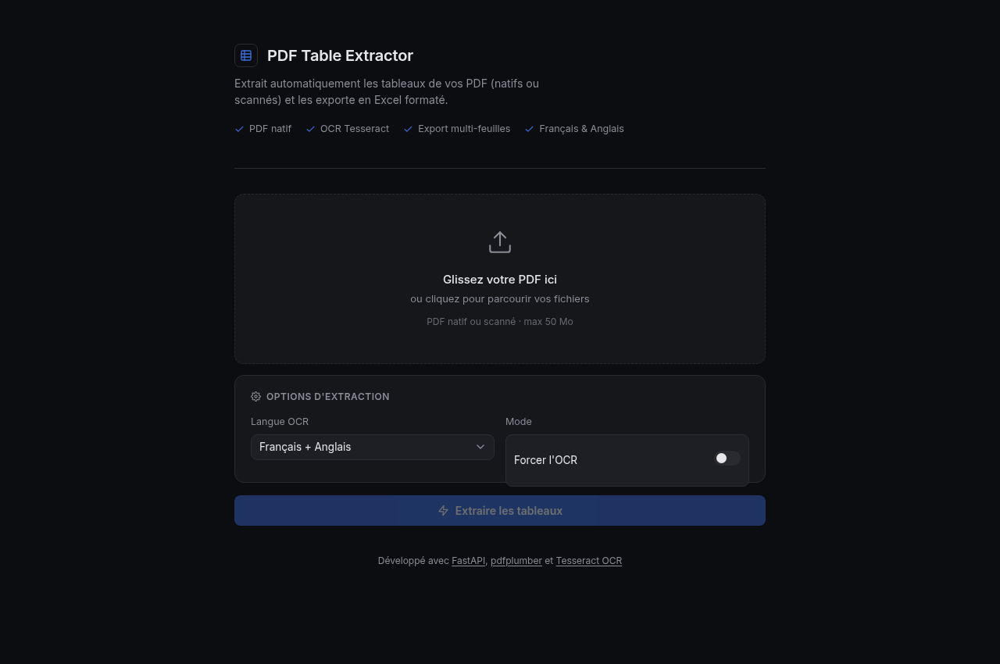

# 📊 PDF Table Extractor

[](https://github.com/Yedmithra/pdf-table-extractor/actions/workflows/ci.yml)
[](LICENSE)
[](https://www.python.org/downloads/)
[](https://fastapi.tiangolo.com/)

Extrait automatiquement les tableaux de vos fichiers PDF (natifs ou scannés) et les exporte en Excel formaté — en un clic, sans configuration.

**🚀 [Essayer la démo en ligne](https://pdf-table-extractor-ut6w.onrender.com)** — sans installation
*(l'instance gratuite se met en veille après inactivité ; le premier chargement peut prendre ~50s)*

[](https://render.com/deploy?repo=https://github.com/Yedmithra/pdf-table-extractor)



## Fonctionnalités

- **PDF natifs** : extraction précise via `pdfplumber` (tableaux délimités par lignes)
- **PDFs scannés** : OCR via `Tesseract` + reconstruction des lignes/colonnes
- **Détection automatique** du type de PDF
- **Export Excel multi-feuilles** avec mise en forme professionnelle (en-têtes colorés, alternance de lignes, feuille de résumé)
- **Interface web** moderne avec drag & drop
- Support **Français + Anglais** (OCR multilingue)

## Démarrage rapide

### Avec Docker (recommandé)

```bash
docker build -t pdf-table-extractor .
docker run -p 8000:8000 pdf-table-extractor
```

Ou avec `make` :

```bash
make docker-run
```

### Sans Docker

#### 1. Prérequis système

```bash
# Ubuntu/Debian
sudo apt install tesseract-ocr tesseract-ocr-fra poppler-utils -y

# macOS
brew install tesseract tesseract-lang poppler
```

#### 2. Environnement Python

```bash
git clone https://github.com/Yedmithra/pdf-table-extractor.git
cd pdf-table-extractor
python -m venv venv
source venv/bin/activate       # Linux/macOS
# venv\Scripts\activate        # Windows

pip install -r requirements.txt
```

Ou avec `make` (voir la section [Makefile](#makefile)) :

```bash
make install
```

#### 3. Lancement

```bash
python -m app.main
```

Ou :

```bash
make run     # sans rechargement automatique
make dev     # avec rechargement automatique
```

L'application est disponible sur : **http://localhost:8000**

## Structure du projet

```
pdf-table-extractor/
├── app/
│   ├── __init__.py
│   ├── main.py          # Serveur FastAPI (routes API + serving HTML)
│   ├── extractor.py     # Logique d'extraction (pdfplumber + OCR)
│   └── templates/
│       └── index.html   # Interface web (drag & drop)
├── examples/
│   └── exemple_extraction.xlsx
├── .github/
│   └── workflows/ci.yml # Lint + smoke test automatiques
├── Dockerfile
├── render.yaml           # Déploiement en un clic sur Render
├── requirements.txt
├── requirements-dev.txt
├── Makefile
├── README.md
└── LICENSE
```

## Makefile

| Cible | Description |
|---|---|
| `make system-deps` | Installe `tesseract-ocr`, `tesseract-ocr-fra`, `poppler-utils` (sudo apt) |
| `make install` | Crée le venv et installe les dépendances Python |
| `make install-dev` | Installe en plus les outils de dev (ruff) |
| `make run` | Lance le serveur en production |
| `make dev` | Lance le serveur avec rechargement automatique |
| `make lint` | Vérifie le code avec ruff |
| `make docker-build` | Construit l'image Docker |
| `make docker-run` | Lance l'image Docker sur le port 8000 |
| `make clean` | Supprime les caches Python |
| `make distclean` | Supprime en plus le venv |

## API

| Endpoint | Méthode | Description |
|---|---|---|
| `GET /` | GET | Interface web |
| `POST /extract` | POST | Upload PDF → extraction JSON |
| `GET /download/{job_id}` | GET | Télécharger le fichier Excel |

### POST /extract

**Body (multipart/form-data)**

| Champ | Type | Description |
|---|---|---|
| `file` | File | Fichier PDF (max 50 Mo) |
| `force_ocr` | bool | Forcer l'OCR même si le PDF est natif |
| `lang` | string | Langue OCR (`fra+eng`, `fra`, `eng`) |

**Réponse**
```json
{
  "job_id": "uuid",
  "filename": "rapport.pdf",
  "tables_found": 3,
  "method": "digital",
  "pages": [1, 2, 4],
  "details": [
    { "sheet": "Page1_T1", "page": 1, "rows": 12, "cols": 5 }
  ]
}
```

## Stratégie d'extraction

```
PDF reçu
    │
    ├── PDF natif (texte extractible) ?
    │       └── pdfplumber (lattice → stream fallback)
    │               └── Si aucun tableau → OCR
    │
    └── PDF scanné (pas de texte) ?
            └── pdf2image (300 dpi) → Tesseract OCR
                    └── Regroupement par position Y → colonnes
```

## Format Excel de sortie

- **Feuille "Résumé"** : liste de tous les tableaux extraits
- **Feuilles données** : une feuille par tableau (`Page1_T1`, `Page2_T1`…)
- En-têtes bleus, alternance de lignes, colonnes auto-dimensionnées
- Valeurs numériques automatiquement converties (int/float)
- Panneaux figés sur la ligne d'en-tête

## Dépendances principales

| Lib | Usage |
|---|---|
| `fastapi` + `uvicorn` | Backend API |
| `pdfplumber` | Extraction tableaux PDF natifs |
| `pdf2image` | Conversion PDF → images pour OCR |
| `pytesseract` | OCR (reconnaissance de caractères) |
| `openpyxl` | Génération fichiers Excel |
| `pandas` | Manipulation des données tabulaires |

## Contribuer

Les contributions sont bienvenues ! Idées de premières issues :

- Amélioration du clustering OCR (regroupement des lignes par position Y)
- Support d'autres langues OCR
- Détection de tableaux fusionnés (cellules merged)

1. Forkez le projet
2. Créez une branche (`git checkout -b feature/ma-fonctionnalite`)
3. Lancez `make lint` avant de commiter
4. Ouvrez une Pull Request

## Licence

[MIT](LICENSE)
