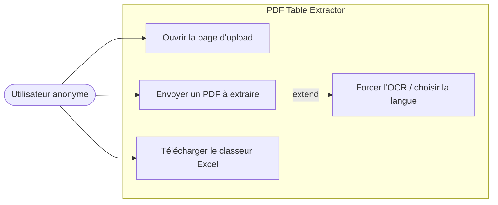
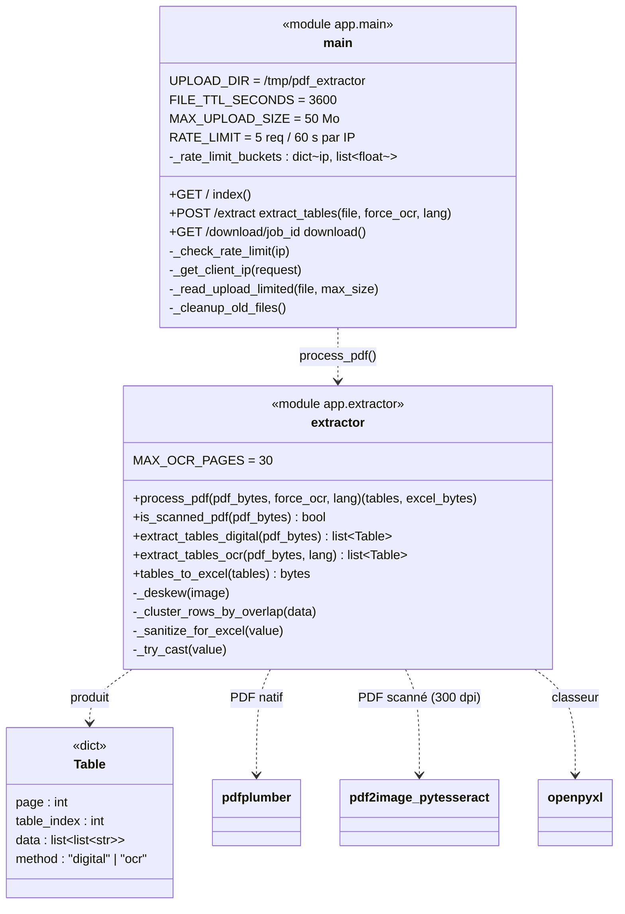
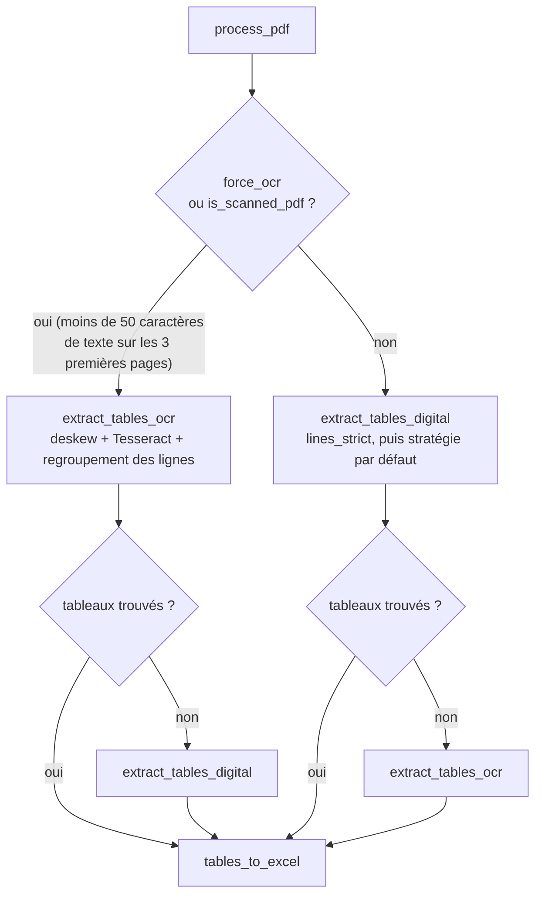
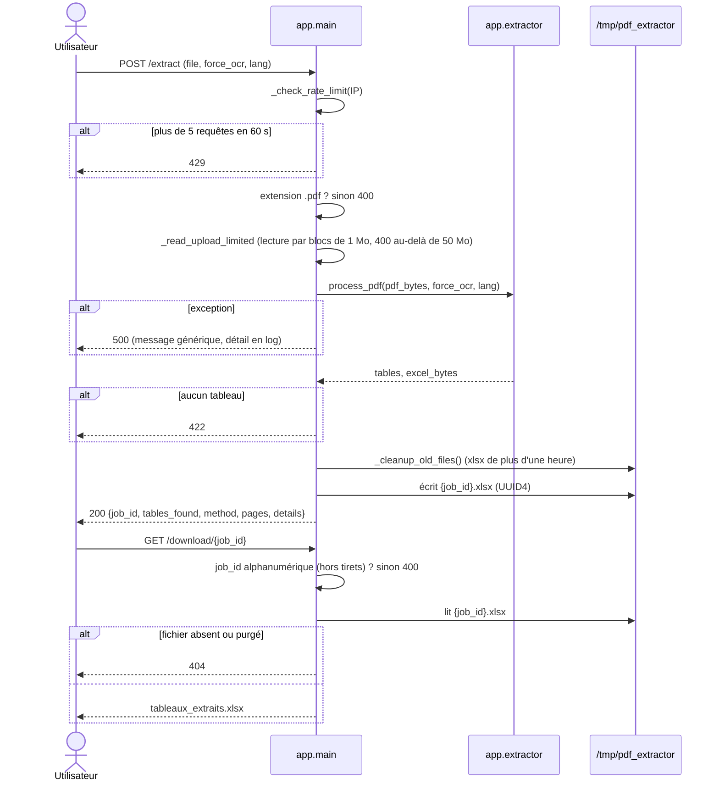
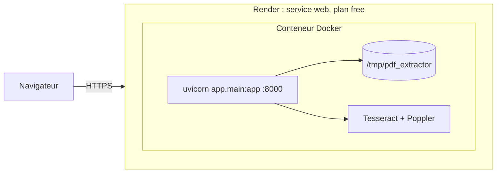

# Diagrammes UML — PDF Table Extractor

Diagrammes établis à partir du code (`app/main.py`, `app/extractor.py`, `Dockerfile`, `render.yaml`). Format Mermaid. L'application n'a ni base de données ni comptes utilisateurs : l'état se limite aux fichiers Excel temporaires et à un compteur de débit en mémoire.

> **Projet en cours de développement.** Ces diagrammes décrivent l'état du code au 17 novembre 2026. Le projet n'est pas terminé et continuera d'évoluer pour être amélioré : les diagrammes, comme le README, pourront donc changer au fil des versions.

## 1. Cas d'utilisation

## 2. Composants (modules et fonctions)

Le classeur contient une feuille « Résumé » en tête, puis une feuille `Page{n}_T{i}` par tableau. `_sanitize_for_excel` neutralise les cellules qui commencent comme une formule.

## 3. Activité : choix de la méthode d'extraction

## 4. Séquence : extraction puis téléchargement

## 5. Déploiement

Le limiteur de débit et les fichiers générés sont locaux à l'instance : le schéma suppose une seule instance.
